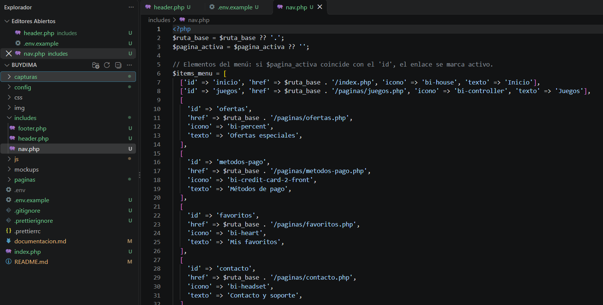
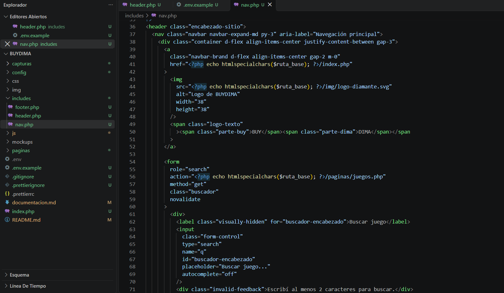
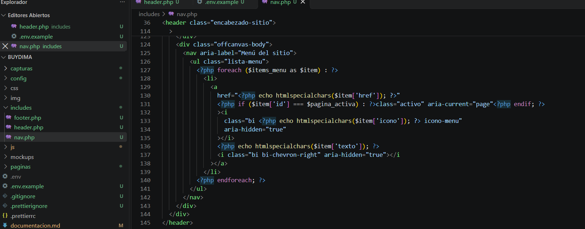
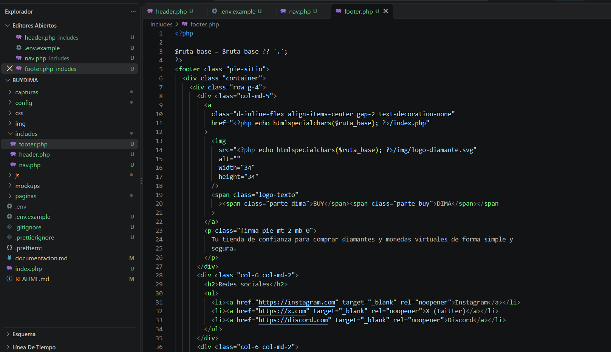
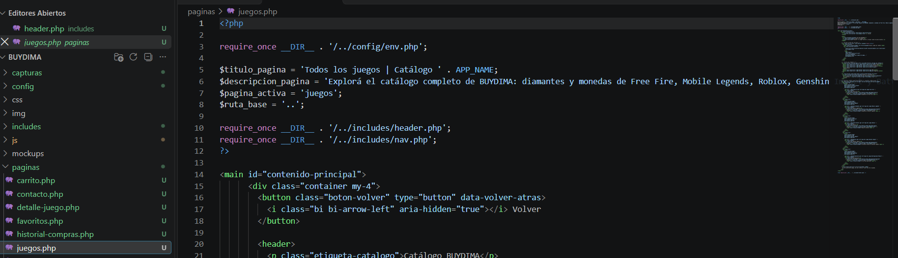

# BUYDIMA — Tienda de recargas de juegos y monedas virtuales

Proyecto de desarrollo de una tienda online de diamantes y monedas virtuales
(Free Fire, Mobile Legends, Roblox, Genshin Impact, Battlegrounds), realizado como
**TP N.º 4 de Programación Web**.

El sitio nació en el TP N.º 3 como maquetación estática (HTML5 + Bootstrap 5) y en este
TP migró a **PHP**: las páginas se renderizan del lado del servidor (SSR), los elementos
comunes se reutilizan con **includes (SSI)** y la configuración se maneja con
**variables de entorno**.

## Diseños en Figma

[Ver proyecto BUYDIMA en Figma](https://www.figma.com/design/FG1K8az0lhOJ4UW6jQHqwA/BUYDIMA?node-id=0-1&t=SuZde1xKh9fQQfyJ-1)

En la carpeta `mockups/` se encuentran las imágenes de las pantallas diseñadas.
Las vistas **detalle de juego** (ID de usuario + selección de paquetes de diamantes y pases) y
**mis favoritos** (juegos guardados en el navegador) se agregaron sobre el diseño
de Figma; queda pendiente incorporarlas al diseño.

## Tecnologías

- PHP 8.x (renderizado del lado del servidor, includes y variables de entorno)
- HTML5 semántico
- CSS3 (estilos personalizados con variables)
- Bootstrap 5 (CDN) + Bootstrap Icons
- JavaScript puro (interacciones, validaciones, carrito y favoritos en localStorage)
- XAMPP o Laragon como servidor local de pruebas
- Prettier (formato de código)
- Git Workflow

## Estructura del proyecto

```
BUYDIMA/
├── index.php                   # Inicio
├── config/
│   └── env.php                 # Cargador de variables de entorno (.env)
├── includes/                   # Componentes comunes (SSI)
│   ├── header.php              # <head>, título dinámico y apertura del documento
│   ├── nav.php                 # Navegación principal, buscador y menú hamburguesa
│   └── footer.php              # Pie de página y scripts
├── paginas/                    # Las otras 9 vistas (juegos, ofertas, carrito, etc.)
├── css/estilos.css             # Estilos personalizados
├── js/main.js                  # Interacciones de todo el sitio
├── img/                        # Imágenes y logos de los juegos
├── mockups/                    # Mockups originales del diseño
├── .env                        # Configuración local (no se sube a GitHub)
├── .env.example                # Ejemplo de configuración (versionado)
├── .gitignore
├── README.md
├── documentacion.md            # Documentación técnica del TP
└── .prettierrc
```

## Cómo ejecutarlo en local

**Requisitos:** PHP 8.x con un servidor local (XAMPP o Laragon), o PHP en el PATH.

**Opción 1 — XAMPP:**

1. Copiar (o clonar) el proyecto en `C:\xampp\htdocs\BUYDIMA`.
2. Iniciar Apache desde el panel de XAMPP.
3. Abrir `http://localhost/BUYDIMA/` en el navegador.

**Opción 2 — Laragon:**

1. Copiar el proyecto en `C:\laragon\www\BUYDIMA`.
2. Iniciar Laragon y pulsar "Start All".
3. Abrir `http://localhost/BUYDIMA/` (o el dominio `http://buydima.test` si usás pretty URLs).

**Opción 3 — servidor embebido de PHP (sin XAMPP ni Laragon):**

1. Abrir una terminal en la carpeta del proyecto.
2. Ejecutar `php -S localhost:8000`.
3. Abrir `http://localhost:8000/` en el navegador.

> Si el proyecto se clona sin el archivo `.env`, copiar `.env.example` como `.env`
> (la aplicación usa valores por defecto si no existe).

## Modularización con includes (SSI)

Los elementos que se repiten en todas las páginas viven en `includes/` y se insertan
con `require_once __DIR__ . '/../includes/...'` en cada página:

- `header.php`: `<head>` con **título dinámico** (`$titulo_pagina`), meta descripción,
  favicon, CSS y apertura del `<body>`.
- `nav.php`: navbar, buscador, accesos al perfil/carrito y menú hamburguesa; marca el
  enlace activo según `$pagina_activa` y agrega `aria-current="page"`.
- `footer.php`: pie de página y scripts.

Las páginas de la raíz usan `$ruta_base = '.'` y las de `paginas/` usan `..`;
las rutas de archivos se resuelven con `__DIR__`, así los includes funcionan igual
desde cualquier nivel.

### 📸 Captura 1 — Sitio funcionando en `http://localhost/BUYDIMA/`


## Títulos dinámicos (SSR)

Cada página define sus variables **antes** de incluir el header:

```php
<?php
$titulo_pagina = 'Mi carrito | ' . APP_NAME;
$pagina_activa = 'carrito';
require_once __DIR__ . '/../includes/header.php';
```

`header.php` imprime el título y `nav.php` marca la sección activa, todo desde el
servidor, sin JavaScript.

### 📸 Captura 2 — Código PHP de los includes (header, nav y footer)

**`includes/header.php`**


**`includes/nav.php`**







**`includes/footer.php`**




### 📸 Captura 3 — Título dinámico y navegación activa




## Variables de entorno

La configuración vive en `.env` (local, ignorado por Git) y se carga con
`config/env.php` (PHP nativo, sin Composer):

```env
APP_NAME=BUYDIMA
SUPPORT_EMAIL=soporte@buydima.com
APP_ENV=local
```

- `APP_NAME` se usa en los `<title>` y en el pie de página.
- `SUPPORT_EMAIL` se muestra en la página de contacto.
- Para cambiar la configuración, editá `.env` (crealo a partir de `.env.example`).

### 📸 Captura 4 — Archivo `.env.example`


## Vistas incluidas (11)

1. Inicio
2. Todos los juegos (catálogo con búsqueda y filtros por categoría)
3. Ofertas especiales (con cuenta regresiva)
4. Métodos de pago
5. Contacto y soporte (formulario validado)
6. Mi carrito (cantidades, código de descuento y resumen)
7. Mi perfil (edición de datos)
8. Historial de compras
9. Mis favoritos (juegos guardados, persisten en el navegador)
10. Menú hamburguesa (componente global en todas las páginas)
11. Detalle de juego (ID de usuario + paquetes de diamantes y pases)

> Todas las interacciones (carrito, favoritos, sesión, formularios) son de
> **demostración**: no hay pagos, cuentas, registros ni envíos reales.

## Documentación

La explicación técnica completa (tecnologías, estructura, SEO, accesibilidad, Prettier,
Lighthouse, includes y variables de entorno) está en [`documentacion.md`](documentacion.md).

---

_Proyecto académico. Todos los juegos y marcas mencionados pertenecen a sus respectivos dueños._
