# BUYDIMA — Tienda de recargas de juegos y monedas virtuales

BUYDIMA es una tienda online de diamantes y monedas virtuales para videojuegos como Free Fire, Mobile Legends, Roblox, Genshin Impact y Battlegrounds.

El sitio permite explorar el catálogo de juegos y productos, consultar ofertas, conocer los métodos de pago y acceder a distintas secciones de información y soporte. También cuenta con un panel administrativo para gestionar los productos almacenados en la base de datos.

El proyecto utiliza PHP para el procesamiento del lado del servidor, MySQL para la persistencia de datos y componentes reutilizables mediante `includes`. Además, incorpora una organización MVC nativa en PHP y un módulo independiente desarrollado con Laravel.

## Diseños en Figma

[Ver proyecto BUYDIMA en Figma](https://www.figma.com/design/FG1K8az0lhOJ4UW6jQHqwA/BUYDIMA?node-id=0-1&t=SuZde1xKh9fQQfyJ-1)

En `mockups/` se encuentran las imágenes de las pantallas diseñadas. Las vistas de detalle de juego (ID de usuario y paquetes) y mis favoritos se desarrollaron directamente en el sitio y quedan pendientes de incorporar al diseño.

## Tecnologías

- PHP 8.x.
- Laravel 13.
- MySQL.
- PDO para conexión y consultas preparadas.
- Eloquent ORM y Query Builder de Laravel.
- HTML5 semántico.
- CSS3.
- Bootstrap 5 (CDN) y Bootstrap Icons.
- JavaScript puro.
- Fetch API para búsquedas dinámicas.
- Sesiones PHP para autenticación y control de acceso.
- Blade para las vistas de Laravel.
- Composer para la gestión de dependencias.
- XAMPP y servidor integrado de PHP para desarrollo local.
- Git y GitHub para control de versiones.

## Estructura del proyecto

```text
BUYDIMA/
├── admin/
├── api/
├── app/
│   ├── Controllers/
│   │   └── ProductoController.php
│   ├── Models/
│   │   └── Producto.php
│   └── Views/
│       └── productos/
│           └── index.php
├── config/
├── css/
├── includes/
├── js/
├── paginas/
├── img/
├── mockups/
├── capturas/
├── clase5/
├── docs/
├── tp6/
├── laravel/
│   ├── app/
│   │   ├── Http/
│   │   │   └── Controllers/
│   │   │       └── ReporteProductoController.php
│   │   └── Models/
│   │       ├── Producto.php
│   │       └── Juego.php
│   ├── bootstrap/
│   ├── config/
│   ├── database/
│   ├── public/
│   ├── resources/
│   │   └── views/
│   │       └── reportes/
│   │           └── productos.blade.php
│   ├── routes/
│   │   └── web.php
│   ├── storage/
│   ├── tests/
│   ├── artisan
│   ├── composer.json
│   └── composer.lock
├── index.php
├── router.php
├── .env.example
├── .gitignore
├── README.md
└── documentacion.md
```

## Cómo ejecutar el proyecto original en local

### Requisitos

- PHP 8.x.
- MySQL.
- XAMPP o un entorno local equivalente.
- Extensiones de PHP `PDO` y `pdo_mysql` habilitadas.

### 1. Configurar la base de datos

Crear la base de datos `buydima` en MySQL y ejecutar los scripts SQL ubicados en `tp6/`:

- `schema.sql`: creación de las tablas y relaciones.
- `consultas.sql`: consultas de comprobación y ejemplos.

El esquema contiene siete tablas:

- `roles`
- `usuarios`
- `juegos`
- `productos`
- `estados_pedido`
- `pedidos`
- `detalle_pedido`

### 2. Configurar las variables de entorno

Crear el archivo `.env` en la carpeta principal del proyecto, tomando como referencia `.env.example`.

Completar los datos de conexión a MySQL:

```env
APP_NAME=BUYDIMA
SUPPORT_EMAIL=soporte@buydima.com
APP_ENV=local

DB_HOST=127.0.0.1
DB_PORT=3306
DB_NAME=buydima
DB_USER=root
DB_PASSWORD=
```

Los valores de conexión deben corresponder a la configuración local de MySQL.

El archivo `.env` contiene información privada y no debe subirse a GitHub. Se encuentra excluido mediante `.gitignore`.

### 3. Iniciar el servidor

Desde una terminal ubicada en la carpeta principal del proyecto, ejecutar:

```powershell
C:\xampp\php\php.exe -S localhost:8000 router.php
```

Abrir en el navegador:

[http://localhost:8000](http://localhost:8000)

El servidor integrado de PHP permite probar el proyecto sin depender de la copia que se encuentre dentro de `htdocs`.

## Modularización con includes

Los elementos que se repiten en las páginas se encuentran en la carpeta `includes/` y se incorporan mediante `require_once`.

- `header.php`: contiene el encabezado HTML, metadatos, título dinámico, CSS y apertura del documento.
- `nav.php`: contiene la navegación principal, el buscador, los accesos al perfil y al carrito, y el menú hamburguesa. También adapta las opciones según el estado de autenticación y el rol del usuario.
- `footer.php`: contiene el pie de página y los scripts.
- `funciones.php`: reúne funciones auxiliares para el procesamiento y la presentación de datos.
- `tabla-productos.php`: permite reutilizar la presentación de los productos.

Las rutas se resuelven mediante `__DIR__` para que los archivos incluidos puedan encontrarse correctamente desde distintos niveles de carpetas.

## Títulos dinámicos y renderizado del lado del servidor

Cada página puede definir sus variables antes de incorporar el encabezado:

```php
<?php

$titulo_pagina = 'Mi carrito | ' . APP_NAME;
$pagina_activa = 'carrito';

require_once __DIR__ . '/../includes/header.php';
```

El título se genera desde PHP y la navegación identifica la sección activa sin depender de JavaScript.

## Variables de entorno y conexión

La configuración se centraliza en el archivo `.env`, que se carga mediante `config/env.php`.

Se utilizan variables para identificar el nombre de la aplicación, el correo de soporte y los datos necesarios para conectarse a MySQL.

La conexión a la base de datos se encuentra centralizada en `config/conexion.php` y utiliza PDO.

La configuración establece:

- Juego de caracteres `utf8mb4`.
- Manejo de errores mediante excepciones.
- Resultados obtenidos como arreglos asociativos.
- Consultas preparadas nativas.

El archivo `.env` no se versiona ni debe quedar accesible desde el navegador. `.env.example` contiene valores de referencia sin credenciales reales.

## Conexión y persistencia de datos

La aplicación utiliza MySQL para almacenar la información y PDO para realizar las operaciones desde PHP.

Las consultas del proyecto original se centralizan en `config/productos.php`, donde se encuentran las funciones para listar, buscar, insertar, actualizar y eliminar productos.

Las operaciones de lectura y escritura utilizan consultas preparadas para evitar la inyección SQL.

## Catálogo público y panel administrativo

El catálogo público permite consultar los juegos y productos disponibles sin acceder al panel de administración.

El panel administrativo se encuentra en `admin/` y permite realizar las operaciones CRUD sobre los productos:

- **Crear:** registrar un producto y asociarlo a un juego.
- **Leer:** consultar el listado de productos almacenados.
- **Actualizar:** modificar los datos de un producto existente.
- **Eliminar:** eliminar productos que no estén asociados a pedidos existentes.

Los formularios realizan validaciones del lado del servidor antes de guardar los cambios.

Cuando un producto está relacionado con pedidos, la base de datos impide su eliminación para conservar el historial de compras.

## Autenticación, sesiones y control de acceso

El proyecto incorpora un sistema de autenticación del lado del servidor mediante PHP y MySQL.

### Registro de usuarios

El archivo `paginas/registro.php` permite crear nuevas cuentas.

Durante el registro:

- Se solicitan nombre, correo electrónico y contraseña.
- Se validan los campos obligatorios y el formato del correo.
- Se comprueba que el correo no esté registrado previamente.
- Se verifica que la contraseña cumpla con la longitud mínima establecida.
- Se almacena la contraseña mediante `password_hash()` utilizando `PASSWORD_BCRYPT`.
- Se asigna automáticamente el rol `cliente` a los usuarios registrados públicamente.

Las consultas se realizan mediante sentencias preparadas de PDO.

### Inicio de sesión

El archivo `paginas/login.php` permite autenticar a los usuarios registrados.

El proceso:

1. Recibe el correo electrónico y la contraseña.
2. Busca al usuario en la base de datos mediante una consulta preparada.
3. Comprueba que la cuenta esté activa.
4. Verifica la contraseña con `password_verify()`.
5. Regenera el identificador de sesión mediante `session_regenerate_id(true)`.
6. Almacena en `$_SESSION` el identificador, nombre y rol del usuario.
7. Redirige al perfil cuando la autenticación es correcta.

Los mensajes de error no exponen información técnica ni datos sensibles de la base de datos.

### Manejo seguro de sesiones

La configuración se encuentra en `config/sesion.php`, mediante la función `iniciar_sesion_segura()`.

Se establecen las siguientes medidas:

- Modo estricto de sesiones mediante `session.use_strict_mode`.
- Cookies de sesión con `HttpOnly`.
- Atributo `SameSite=Lax`.
- Atributo `Secure` cuando la conexión utiliza HTTPS.
- Duración de la cookie limitada a la sesión del navegador.
- Regeneración del identificador después del inicio de sesión.

### Protección de páginas

El archivo `config/auth_guard.php` centraliza las funciones de control de acceso:

- `requiere_login()`: comprueba que exista una sesión autenticada. Si no existe, redirige al formulario de inicio de sesión.
- `requiere_administrador()`: comprueba que el usuario esté autenticado y que tenga el rol `administrador`. Si no cuenta con los permisos necesarios, devuelve un código HTTP 403.

Estas funciones se utilizan al comienzo de las páginas que requieren protección, antes de generar contenido HTML.

### Roles de usuario

El sistema utiliza los roles almacenados en la tabla `roles`:

- `cliente`: puede acceder a las secciones protegidas para usuarios autenticados.
- `administrador`: puede acceder al perfil y al panel de administración.

Las páginas administrativas verifican los permisos del usuario desde el servidor. Ocultar los enlaces del menú no reemplaza esta comprobación.

### Cierre de sesión

El archivo `paginas/logout.php` permite cerrar la sesión mediante:

- Limpieza de los datos almacenados en `$_SESSION`.
- Eliminación de la cookie de sesión.
- Destrucción de la sesión mediante `session_destroy()`.

Después del cierre de sesión, las páginas protegidas vuelven a requerir autenticación.

## Búsqueda dinámica de productos

El catálogo incorpora una búsqueda dinámica mediante JavaScript y Fetch API.

El archivo `api/buscar_productos.php` recibe el término de búsqueda, consulta los productos y devuelve los resultados en formato JSON.

La interacción se realiza sin recargar la página. El archivo `js/main.js` procesa la respuesta y actualiza el listado de productos mostrado en el catálogo.

## Refactorización a MVC nativo en PHP

Como parte del Trabajo Práctico N.º 10, se refactorizó el módulo del catálogo de productos utilizando el patrón Modelo-Vista-Controlador (MVC).

La estructura incorporada es:

```text
app/
├── Controllers/
│   └── ProductoController.php
├── Models/
│   └── Producto.php
└── Views/
    └── productos/
        └── index.php
```

Cada componente tiene una responsabilidad diferenciada:

- **Modelo (`Producto.php`):** contiene las operaciones relacionadas con los datos de los productos y las consultas a la base de datos mediante PDO.
- **Controlador (`ProductoController.php`):** recibe la solicitud, solicita los datos al modelo y prepara la información que necesita la vista.
- **Vista (`index.php`):** se encarga de presentar los productos mediante HTML y los componentes reutilizables del proyecto.

El archivo `paginas/productos.php` funciona como punto de entrada del módulo y delega el procesamiento al controlador.

Esta organización separa el acceso a datos, la lógica de procesamiento y la presentación, facilitando el mantenimiento y la reutilización del código.

La búsqueda dinámica incorporada anteriormente mediante Fetch API se conserva.

## Implementación de módulo con Laravel

También se incorporó un proyecto Laravel independiente dentro de la carpeta `laravel/`, sin reemplazar ni modificar el funcionamiento del sitio PHP original.

Para el Trabajo Práctico N.º 10 se desarrolló un módulo de reportes de productos.

### Estructura del módulo

```text
laravel/
├── app/
│   ├── Http/
│   │   └── Controllers/
│   │       └── ReporteProductoController.php
│   └── Models/
│       ├── Producto.php
│       └── Juego.php
├── resources/
│   └── views/
│       └── reportes/
│           └── productos.blade.php
└── routes/
    └── web.php
```

### Componentes

- **Ruta (`routes/web.php`):** define el acceso al reporte de productos.
- **Controlador (`ReporteProductoController.php`):** obtiene los datos necesarios y prepara la información del reporte.
- **Modelos (`Producto.php` y `Juego.php`):** representan las entidades de la base de datos y permiten trabajar con sus registros mediante Eloquent ORM.
- **Vista (`productos.blade.php`):** utiliza Blade para presentar los resultados.

### Funcionalidad del reporte

El módulo muestra información de los productos activos:

- Cantidad total de productos activos.
- Stock total.
- Precio promedio.
- Listado de productos con su juego, precio y stock.

La ruta de acceso es:

```text
/reportes/productos
```

El módulo utiliza la base de datos `buydima`, por lo que consulta los datos existentes del proyecto.

### Ejecutar Laravel en local

Para ejecutar este módulo se necesita PHP, Composer y MySQL.

1. Abrir una terminal dentro de la carpeta `laravel/`.
2. Instalar las dependencias:

```bash
composer install
```

3. Crear el archivo `.env` tomando como referencia `.env.example` y configurar la conexión a la base de datos `buydima`.

4. Generar la clave de la aplicación:

```bash
php artisan key:generate
```

5. Configurar `SESSION_DRIVER=file` en el `.env` para utilizar sesiones almacenadas en archivos.

6. Limpiar la configuración almacenada:

```bash
php artisan config:clear
```

7. Iniciar el servidor:

```bash
php artisan serve --port=8001
```

Abrir en el navegador:

[http://127.0.0.1:8001/reportes/productos](http://127.0.0.1:8001/reportes/productos)

El módulo Laravel se ejecuta de forma independiente al servidor PHP original.

El archivo `laravel/.env` contiene la configuración local y no debe subirse a GitHub. Las dependencias instaladas en `laravel/vendor/` tampoco se versionan.

## Medidas de seguridad

Se aplican distintas medidas para proteger los datos y las operaciones de la aplicación:

- Consultas preparadas mediante PDO para evitar inyección SQL.
- Validación de los datos recibidos mediante formularios.
- Uso de `htmlspecialchars()` para escapar los valores dinámicos que se muestran en HTML.
- Variables de entorno para mantener separadas las credenciales de la configuración del código.
- Exclusión de los archivos `.env` mediante `.gitignore`.
- Protección del acceso directo al archivo `.env` mediante la configuración del servidor.
- Eliminación de productos mediante solicitudes POST y confirmación previa.
- Restricciones de claves foráneas para conservar la integridad de los datos relacionados con pedidos.
- Almacenamiento de contraseñas mediante `password_hash()`.
- Verificación de contraseñas mediante `password_verify()`.
- Regeneración del identificador de sesión después de autenticar al usuario.
- Protección de las cookies de sesión mediante los atributos `HttpOnly`, `SameSite` y `Secure` cuando corresponde.
- Control de acceso a páginas privadas según el estado de autenticación y el rol del usuario.

## Vistas y funcionalidades

El sitio contiene distintas secciones:

1. Inicio.
2. Todos los juegos, con búsqueda y filtros por categoría.
3. Ofertas especiales, con cuenta regresiva.
4. Métodos de pago.
5. Contacto y soporte, con formulario validado.
6. Mi carrito, con cantidades, código de descuento y resumen.
7. Registro e inicio de sesión.
8. Mi perfil.
9. Historial de compras.
10. Mis favoritos, almacenados en el navegador.
11. Menú hamburguesa y navegación global.
12. Detalle de juego, con identificación del usuario y selección de paquetes.
13. Panel administrativo para gestionar productos.
14. Reporte de productos desarrollado con Laravel.

Las interacciones de carrito, favoritos y algunas funciones de perfil son demostrativas y utilizan almacenamiento local del navegador. No se encuentran implementados los pagos ni los envíos reales de recargas.

## Capturas

### Sitio en funcionamiento

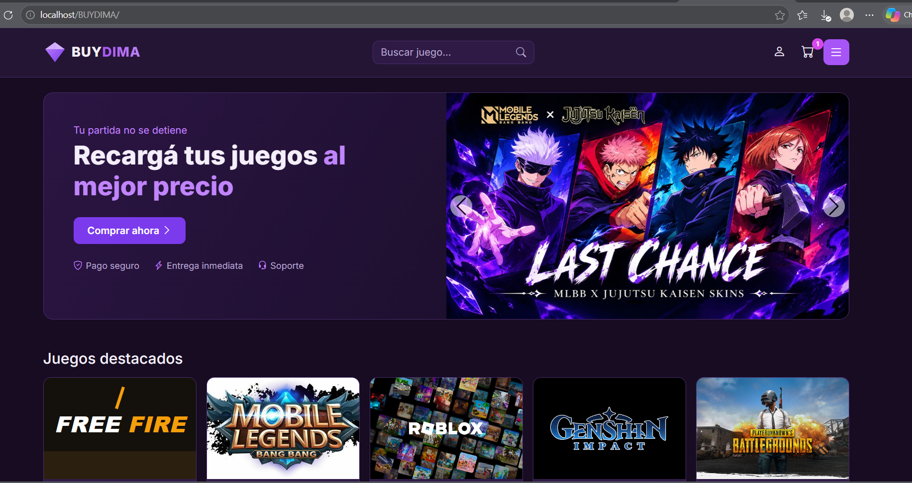

### Includes: header, nav y footer

**`includes/header.php`**

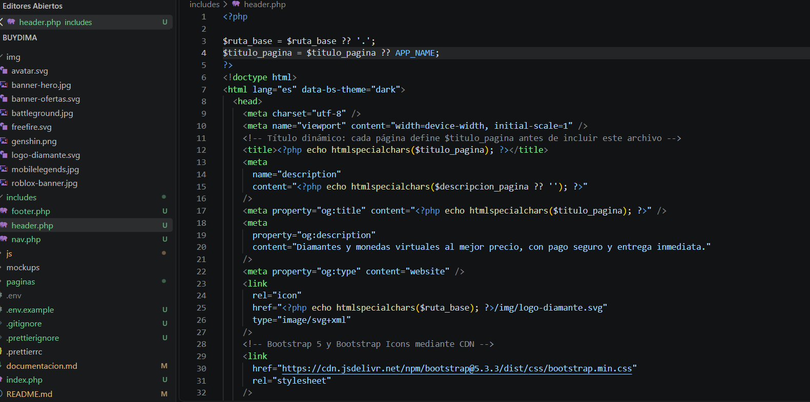

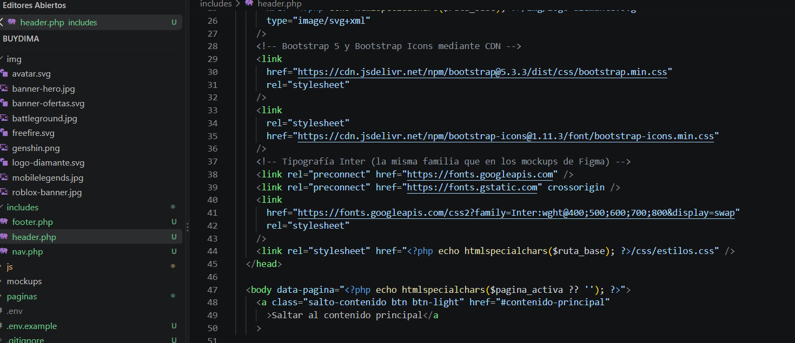

**`includes/nav.php`**


**`includes/footer.php`**


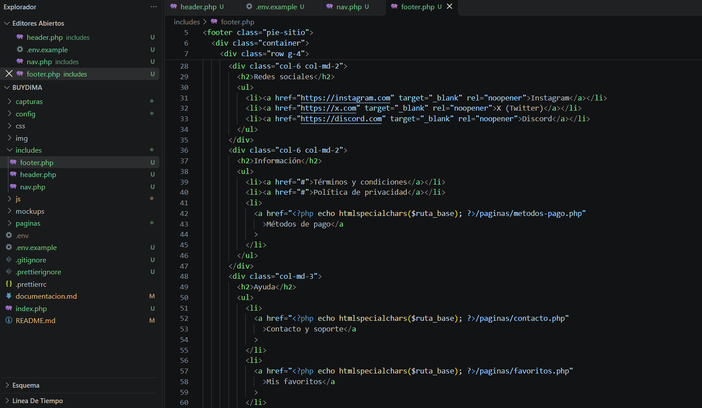

### Título dinámico y navegación activa

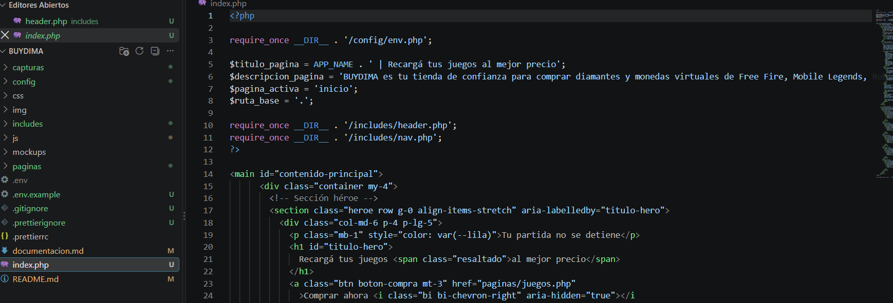


### Variables de entorno

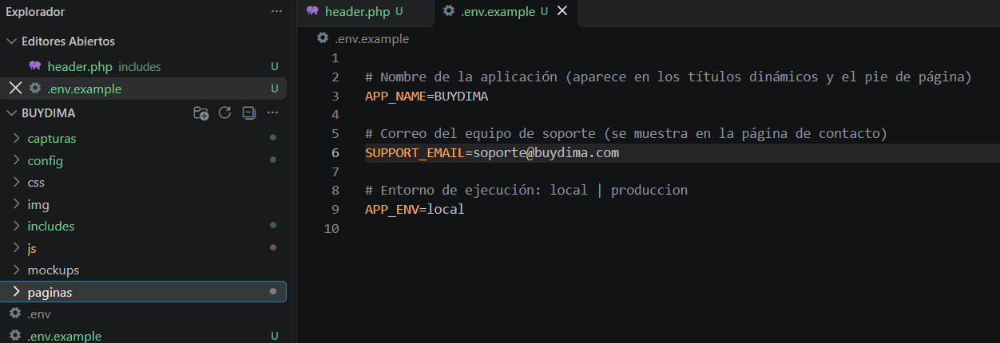

### Formularios y búsqueda

**1. Formulario de contacto vacío**

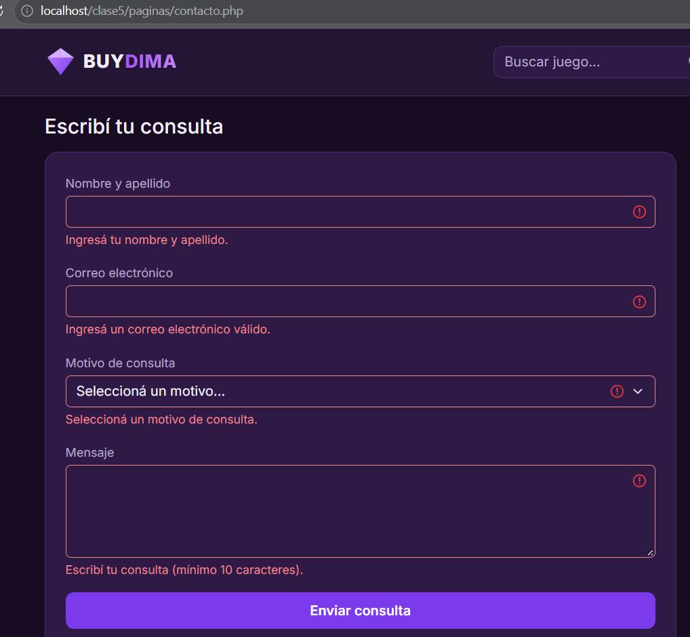

**2. Error de correo inválido**

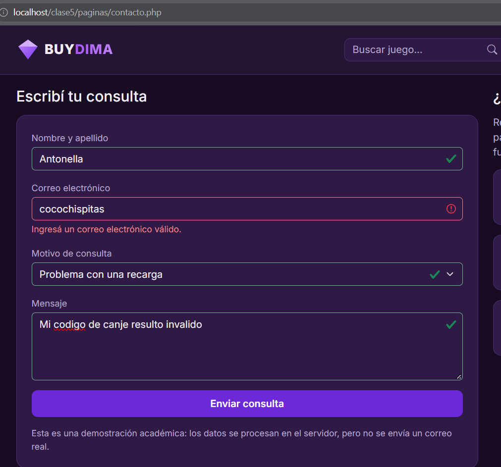

**3. Consulta enviada correctamente**

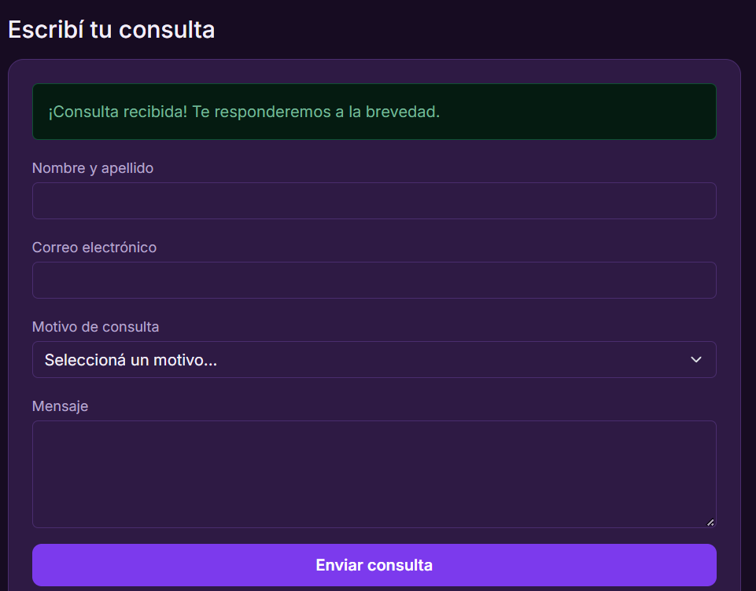

**4. Búsqueda mediante GET**

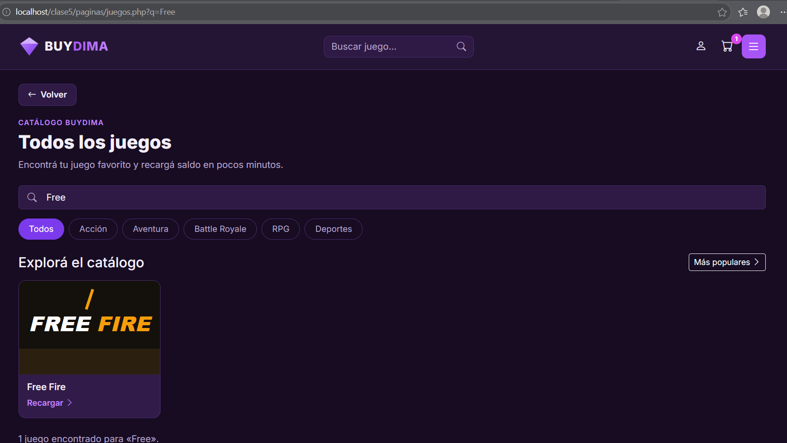

**5. Filtro por categoría**

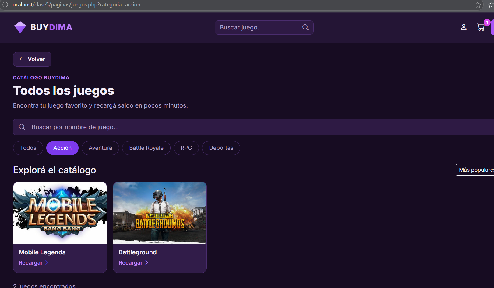

**6. Mensaje sin resultados**

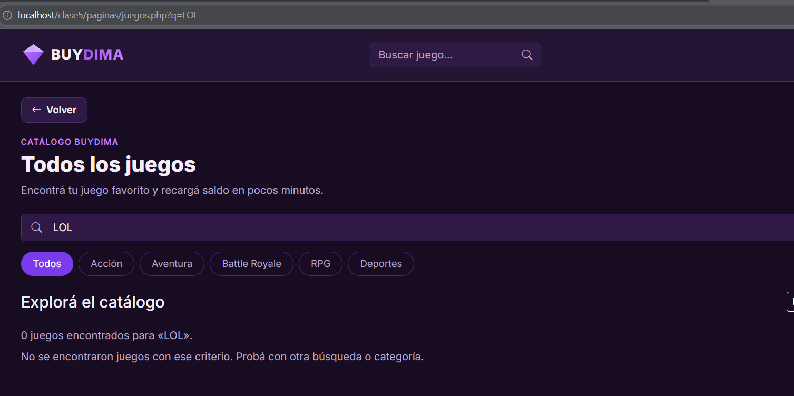

## Sitio web publicado en GitHub Pages

La versión estática del sitio se conserva en la carpeta `docs/`, con su propio `css/`, `js/`, `img/` y las páginas HTML. El archivo `index.html` de la raíz redirige a esa carpeta para que GitHub Pages muestre el sitio web en lugar de la documentación.

Para publicarlo, en el repositorio de GitHub hay que abrir **Settings → Pages** y elegir la rama `main` con la carpeta `/docs` como origen. La aplicación PHP se sigue ejecutando por separado en un servidor con PHP y MySQL.

## Documentación

La explicación técnica y el desarrollo de las funcionalidades se encuentran en [documentacion.md](documentacion.md).

---

*Proyecto académico. Todos los juegos y marcas mencionados pertenecen a sus respectivos propietarios.*
